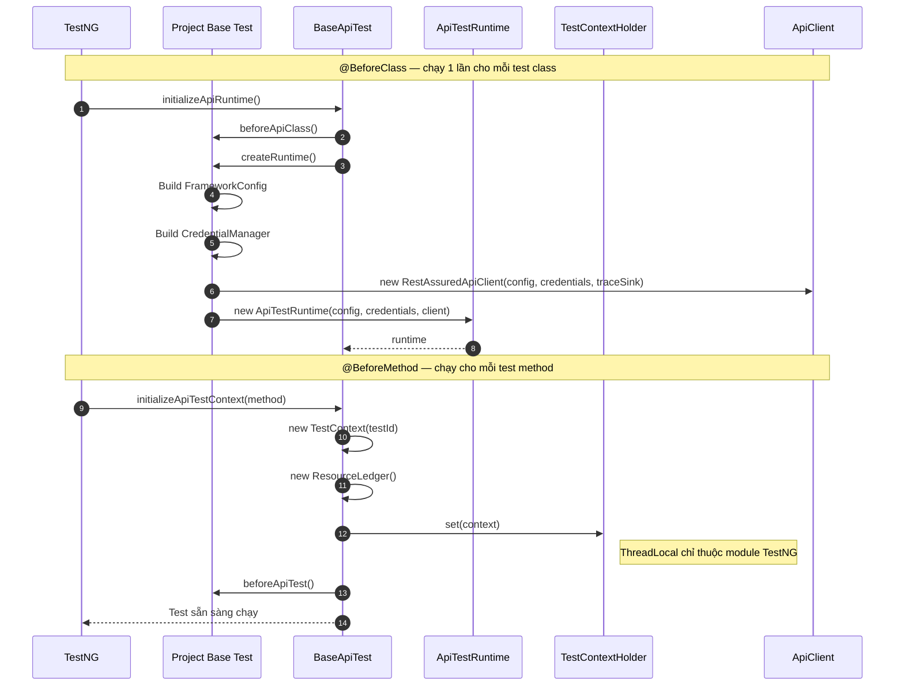
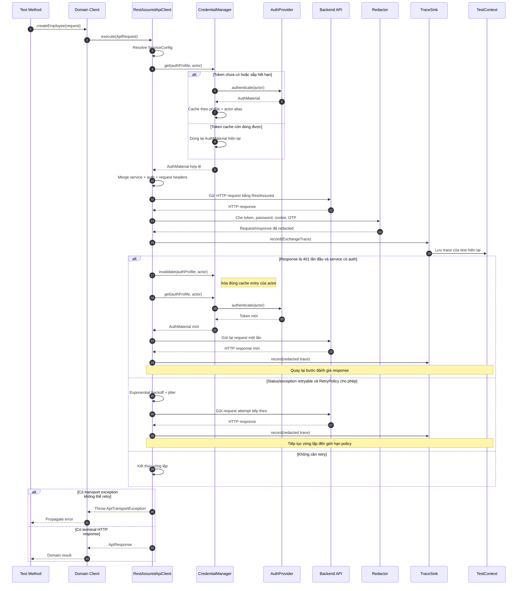
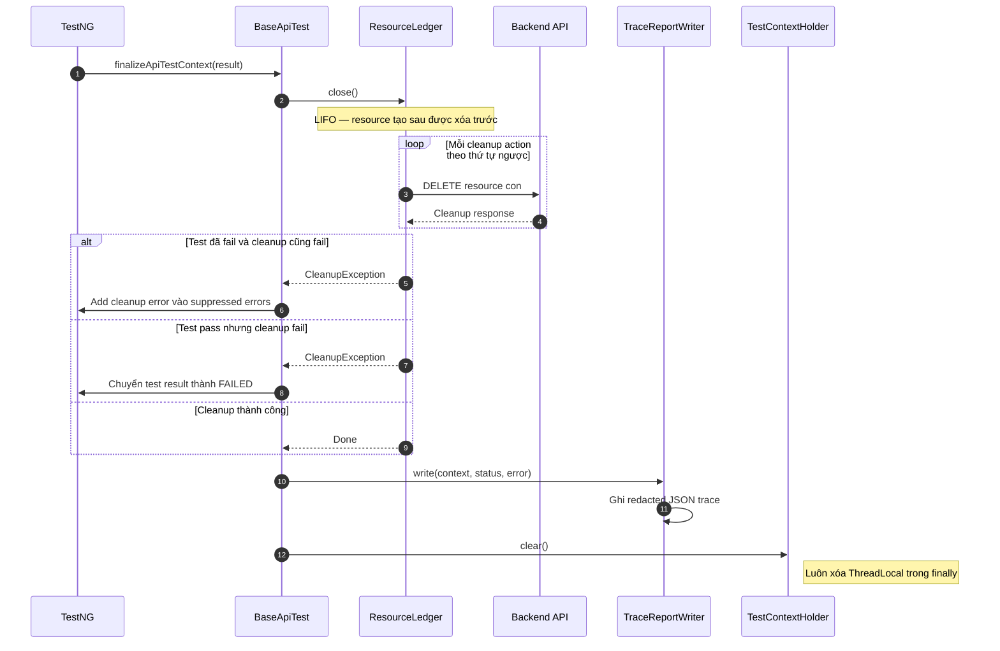
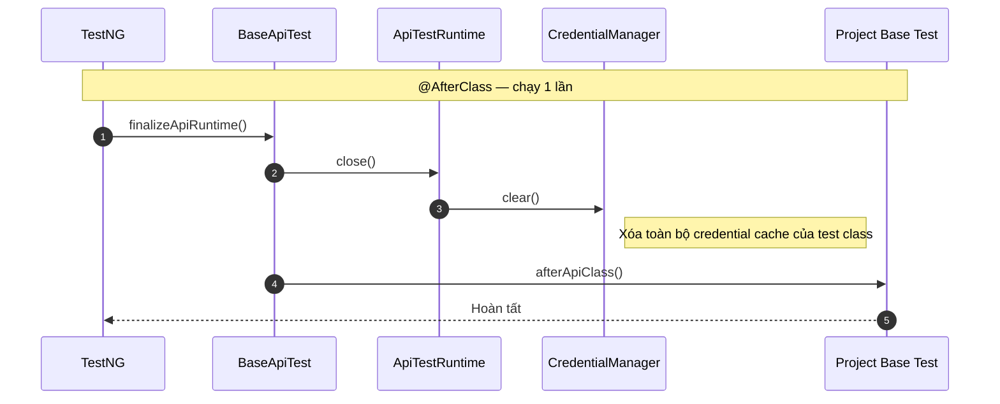

# Luồng hoạt động của API Framework

Tài liệu này mô tả ba luồng chính của framework theo thứ tự thời gian: **khởi tạo test**,
**thực thi request** và **dọn dẹp sau test**.

---

## 1. Luồng khởi tạo test

Framework chia khởi tạo thành hai tầng:

- Tầng runtime chạy một lần cho mỗi test class.
- Tầng context chạy lại cho từng test method.



### Ý nghĩa

1. `ApiTestRuntime` giữ config, credential cache và HTTP client nên chỉ được tạo một lần cho test class.
2. `TestContext` và `ResourceLedger` được tạo mới cho từng method, tránh chia sẻ trace và resource giữa các test.
3. Consumer chỉ cần wiring một lần trong project base test; test business dùng lại `api()`, `context()` và `resources()`.

---

## 2. Luồng thực thi request và authentication

Đây là luồng chạy khi domain client gọi `api.execute(ApiRequest)`.



### Quy tắc retry

| Chế độ | Hành vi |
|---|---|
| `DEFAULT` | Chỉ tự retry method an toàn như GET, HEAD và OPTIONS |
| `NEVER` | Không retry |
| `IDEMPOTENT` | Cho phép retry mutation nhưng bắt buộc có `Idempotency-Key` |

Refresh do `401` chỉ xảy ra tối đa một lần cho mỗi request. Nếu response sau refresh vẫn là `401`, framework trả
response về test thay vì tạo vòng lặp login vô hạn.

---

## 3. Luồng dọn dẹp và ghi report

`@AfterMethod(alwaysRun = true)` vẫn chạy khi test pass, fail hoặc bị skip.



Ví dụ thứ tự resource:

```text
Tạo:  Organization A -> Employee B -> Contract C
Xóa:  Contract C     -> Employee B -> Organization A
```

Nhờ LIFO, resource con luôn được xóa trước resource cha.

---

## 4. Luồng kết thúc test class



---

## 5. Wiring tối thiểu ở consumer

```java
public abstract class HrmApiTest extends BaseApiTest {
    @Override
    protected ApiTestRuntime createRuntime() {
        FrameworkConfig config = HrmTestConfig.fromEnvironment();
        CredentialManager credentials = HrmAuth.createCredentialManager(config);

        ApiClient api = new RestAssuredApiClient(
                config,
                credentials,
                new CurrentTestTraceSink());

        return new ApiTestRuntime(config, credentials, api);
    }
}
```

```text
api_hrm / api-map
├── config       FrameworkConfig từ environment và secret provider
├── auth         AuthProvider cho từng auth profile
├── clients      Domain clients, không gọi RestAssured trực tiếp
├── fixtures     Tạo data và đăng ký ResourceLedger cleanup
├── scenarios    Business flows dùng lại được
└── tests        Test matrix và assertions
```
