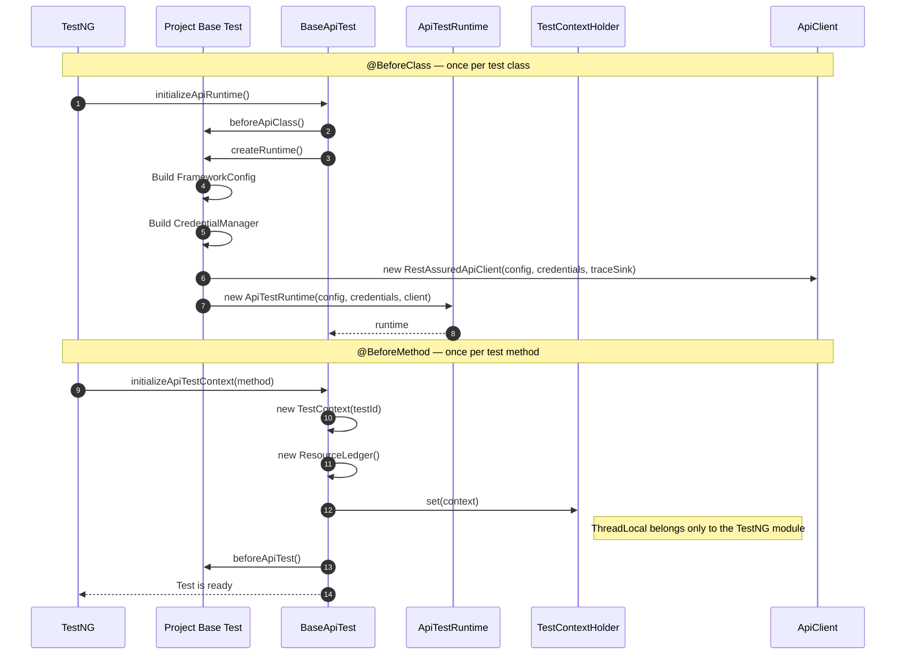
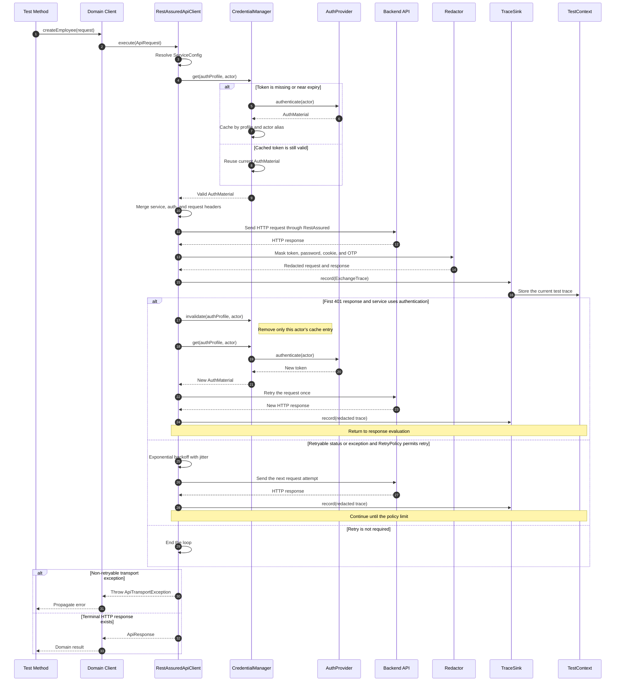
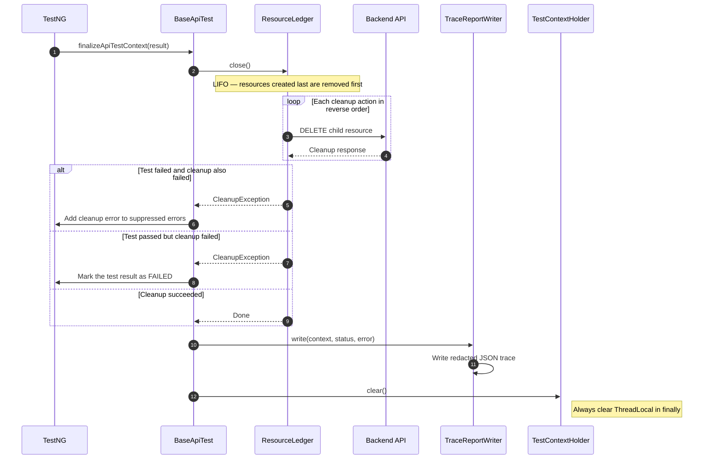
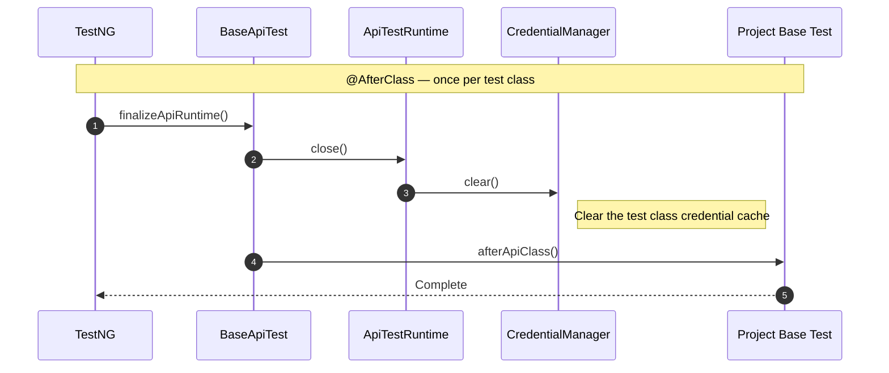

# API Framework Execution Flows

This document describes the framework's three main flows in chronological order: **test initialization**, **request execution**, and **post-test cleanup**.

## 1. Test initialization

Initialization is split into two layers:

- The runtime layer runs once per test class.
- The context layer runs once per test method.



### Rationale

1. `ApiTestRuntime` owns configuration, the credential cache, and the HTTP client, so it is created once per test class.
2. A fresh `TestContext` and `ResourceLedger` are created for every method to prevent trace and resource sharing between tests.
3. Consumers wire the runtime once in their project base test; business tests reuse `api()`, `context()`, and `resources()`.

## 2. Request execution and authentication

This flow starts when a domain client calls `api.execute(ApiRequest)`.



### Retry rules

| Mode | Behavior |
|---|---|
| `DEFAULT` | Automatically retries only safe methods such as GET, HEAD, and OPTIONS |
| `NEVER` | Never retries |
| `IDEMPOTENT` | Allows mutation retries but requires an `Idempotency-Key` |

A `401` refresh occurs at most once per request. If the response after refresh is still `401`, the framework returns it to the test instead of creating an infinite authentication loop.

## 3. Cleanup and report generation

`@AfterMethod(alwaysRun = true)` runs whether the test passes, fails, or is skipped.



Example resource order:

```text
Create: Organization A -> Employee B -> Contract C
Delete: Contract C     -> Employee B -> Organization A
```

LIFO ensures that child resources are always removed before their parents.

## 4. Test class shutdown



## 5. Minimal consumer wiring

```java
public abstract class HrmApiTest extends BaseApiTest {
    @Override
    protected ApiTestRuntime createRuntime() {
        FrameworkConfig config = HrmTestConfig.fromEnvironment();
        CredentialManager credentials = HrmAuth.createCredentialManager(config);

        ApiClient api = new RestAssuredApiClient(
                config,
                credentials,
                new CurrentTestTraceSink());

        return new ApiTestRuntime(config, credentials, api);
    }
}
```

```text
your-consumer-project
├── config       FrameworkConfig from the environment and secret provider
├── auth         AuthProvider for each authentication profile
├── clients      Domain clients; never call RestAssured directly
├── fixtures     Create data and register ResourceLedger cleanup
├── scenarios    Reusable business flows
└── tests        Test matrices and assertions
```
